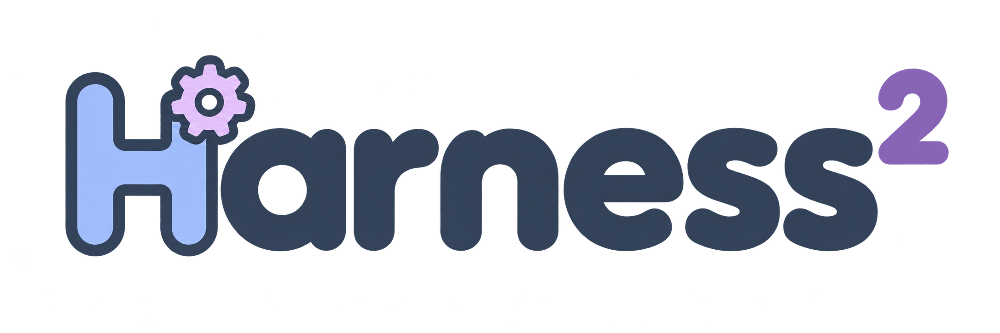
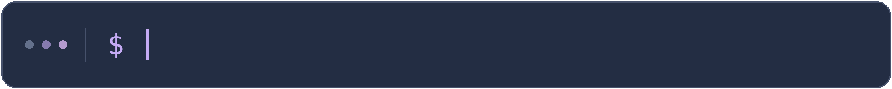
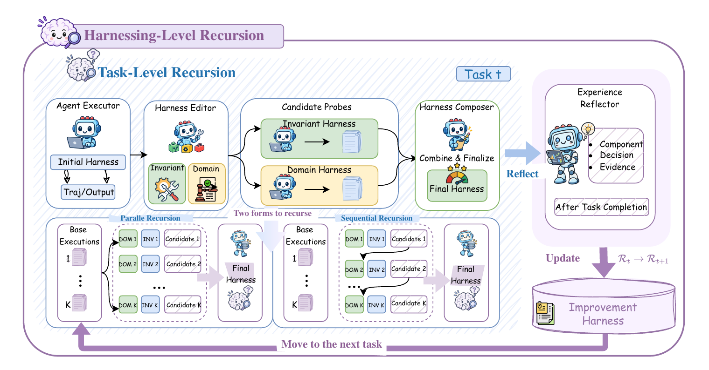
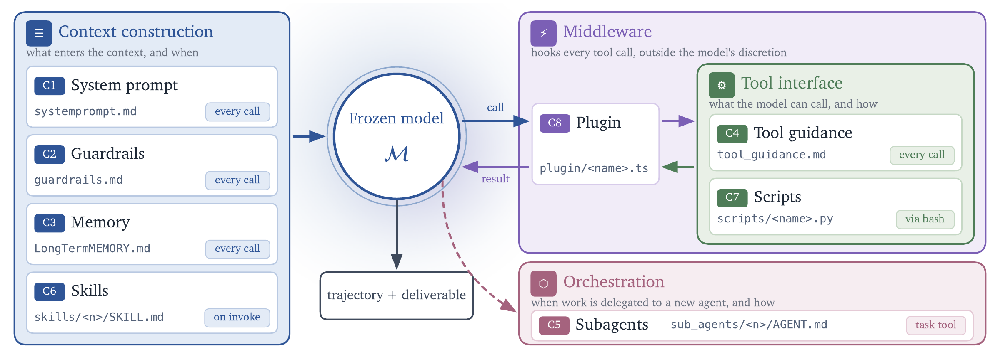
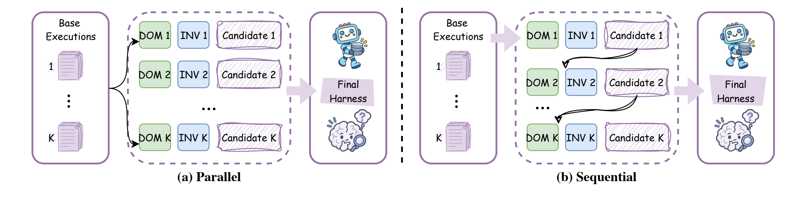

<h3 align="center">
  <br>
  열린 세계를 위한 재귀적 에이전트 하네스 최적화
</h3>

<p align="center">
  <a href="https://arxiv.org/pdf/2610.14224"></a>
  <a href="https://harness2.github.io"></a>
  <a href="docs/BENCHMARKS.md"></a>
  <a href="LICENSE"></a>
</p>

<p align="center">
  <a href="README.md">English</a> | <a href="README.ko.md">한국어</a>
</p>

<p align="center">
  <a href="docs/BENCHMARKS.md#jobbench">
    
  </a>
</p>

**하네스(harness)**는 모델이 에이전트로 동작할 수 있게 하는 주변 시스템으로,
프롬프트, 도구, 메모리, 스킬, 오케스트레이션 등을 포함합니다.
**하네스 최적화(harnessing)**는 이 시스템을 최적화하는 과정입니다.

Harness²는 하네스 설계 시점에 보지 못한 작업을 에이전트가 마주하는 열린 세계에서
**재귀적 에이전트 하네스 최적화**를 수행하는 플러그 앤 플레이 프레임워크입니다.
모델 가중치를 고정한 채 두 수준의 재귀를 연결합니다.

* **작업 수준 재귀**는 대조 기반의 **제안–탐색–합성(Propose–Probe–Compose)**
  단계를 통해 현재 작업의 실행 하네스를 개선합니다. 수정안을 제안하고, 동일한
  작업에서 그 효과를 탐색한 뒤, 정답 피드백 없이 실행 간 행동 차이를 바탕으로
  개선된 하네스를 합성합니다.
* **하네스 최적화 수준 재귀**는 각 작업에서 채택한 하네스와 증거로 뒷받침되는
  교훈을 지속적으로 유지되는 *개선 하네스(improvement harness)*에 반영하여
  이후의 개선을 이끕니다.

<p align="center">
  <a href="assets/harness2_pipeline.png">
    
  </a>
</p>

세 가지 전문 업무 벤치마크와 네 가지 모델–하네스 구성에서, Harness²를 한 단계
적용하면 GLM-5와 Gemini 3.5 Flash의 성능이 기본 하네스 대비 향상됩니다.
향상 폭은 WorkBuddy-Bench에서 최대 11.5점, JobBench에서 최대 4.5점이며,
LAB의 부분 통과율은 최대 11.8%p 증가합니다. 작업 수준 재귀 예산을 늘리면
추가적인 성능 향상을 얻을 수 있습니다.

이 릴리스는 **병렬 및 순차 재귀**, **OpenCode 및 Codex 실행기**,
**JobBench, LAB, WorkBuddy-Bench**를 지원합니다.

## 소개 영상

https://github.com/user-attachments/assets/76b10548-b14b-4c8f-9aa5-a93662df4d56

## 목차

- [소개 영상](#소개-영상)
- [하네스 구성 요소](#하네스-구성-요소)
- [설치](#설치)
- [벤치마크 실행](#벤치마크-실행)
- [실험](#실험)
- [웹 접근](#웹-접근)
- [결과 및 재개](#결과-및-재개)
- [인용](#인용)
- [기여](#기여)
- [라이선스](#라이선스)
- [면책 조항](#면책-조항)

## 하네스 구성 요소

Harness²는 모델 주변의 여덟 가지 구성 요소를 수정할 수 있도록 제공합니다.
**시스템 프롬프트, 가드레일, 메모리, 도구 사용 지침, 하위 에이전트, 스킬,
스크립트, 플러그인**이 이에 해당합니다. 이 구성 요소들은 컨텍스트 구성,
도구 인터페이스, 작업 위임, 도구 루프 내 동작을 제어합니다.

<p align="center">
  <a href="assets/components.png">
    
  </a>
</p>

## 설치

**Linux, Python 3.12, [uv](https://docs.astral.sh/uv/getting-started/installation/)**를 사용하세요.
저장소 루트에서 다음 명령어를 실행합니다.

```bash
uv venv --python 3.12 .venv
source .venv/bin/activate
uv pip install -e '.[render]'
harness2-demo --output runs/demo --k 2
```

로컬 데모는 결정론적 편집기와 실제 Python 실행을 사용하여 두 가지 재귀 모드를
모두 실행합니다. 모델 인증 정보는 필요하지 않습니다.

모델을 사용하는 벤치마크를 실행하려면 **Node.js 20 이상, Google Cloud CLI**와
[벤치마크 의존성](docs/SETUP.md#requirements)을 설치하세요. LAB에는 Pandoc과
Poppler가, WorkBuddy-Bench에는 Docker가 필요합니다. 그런 다음 모델을 설정합니다.

```bash
cp .env.example .env
# .env에 Vertex AI 프로젝트와 모델 ID를 설정합니다.
gcloud auth application-default login
```

모델 설정, 다른 인증 방법, [Codex 실행기](docs/SETUP.md#codex-executor)에 관한
자세한 내용은 [설정 가이드](docs/SETUP.md)를 참고하세요.

## 벤치마크 실행

다음 예시는 LAB을 설치하고 작업 하나를 실행한 뒤, 결과를 평가하고 보고서를
생성합니다. 모델을 사용하는 실행에는 API 비용이 발생하므로 적은 수의 작업부터
시작하세요.

```bash
harness2-setup lab
harness2-check --bench lab
harness2 --bench lab --k 1 --mode parallel \
  --only-domains antitrust-competition --max-tasks 1
harness2-judge --bench lab --k 1 --mode parallel
harness2-report --bench lab --k 1 --mode parallel
```

순차 재귀는 같은 명령어에 `--mode sequential`을 사용하여 실행합니다.
`--k`는 작업 수준 재귀 예산입니다. [실험](#실험)을 참고하세요. 평가와 보고서
생성 시에는 개선 실행과 동일한 벤치마크, 실행기, 하위 집합, `--k`, `--mode`,
시드를 사용해야 합니다. `harness2`에 `--dry-run`을 추가하면 모델 호출 없이
선택될 작업을 미리 확인할 수 있습니다.

| 벤치마크 | 작업 | 설치 | 가이드 |
|---|---|---|---|
| JobBench | 전문 업무 | `harness2-setup jb` | [JobBench](docs/BENCHMARKS.md#jobbench) |
| LAB | 법률 업무 | `harness2-setup lab` | [LAB](docs/BENCHMARKS.md#lab) |
| WorkBuddy-Bench | 사무, 웹, 코드 | `harness2-setup wb` | [WorkBuddy](docs/BENCHMARKS.md#workbuddy-bench) |

명령어마다 벤치마크 하나를 선택하세요. WorkBuddy는 설치 이후의 모든 명령어에
`--subset office`, `--subset web`, `--subset code` 중 하나를 지정해야 합니다.
각 벤치마크의 데이터, 도메인, 채점에 관한 내용은
[벤치마크 가이드](docs/BENCHMARKS.md)를 참고하세요.

## 실험

작업 수준 재귀를 확장하는 방법은 두 가지입니다. **병렬 재귀**는 여러 후보
하네스를 탐색하고 실행 증거를 바탕으로 개선안을 합성합니다. **순차 재귀**는
개선된 하네스와 누적된 증거를 연속적인 제안–탐색–합성 단계로 전달합니다.

<p align="center">
  <a href="assets/harness2_recursion_modes.png">
    
  </a>
</p>
<p align="center"><em>병렬 재귀는 더 넓게 탐색하고, 순차 재귀는 더 깊이 개선합니다.</em></p>

| 옵션 | 동작 |
|---|---|
| `--k 1` | 제안–탐색–합성 단계 1회 수행 |
| `--k K --mode parallel` | 일반 후보 `K`개와 도메인 특화 후보 `K`개를 탐색한 뒤, `K`개의 합성 결과 생성 |
| `--k K --mode sequential` | 연속된 `K`개 단계를 통해 하네스 개선 |
| `--substrate cx` | 기본 OpenCode 실행기 대신 Codex 사용 |

각 작업이 끝나면 하네스 최적화 수준 재귀는 채택된 하네스와 증거로 뒷받침되는
교훈을 보존하여 이후의 개선을 이끕니다. 작업 선택, 동시 실행, 재현성,
기준선 비교에 관한 내용은 [실험 가이드](docs/EXPERIMENTS.md)를 참고하세요.

## 웹 접근

실행기의 네트워크 접근에는 제한이 없으며, Codex는 샌드박스가 비활성화된 상태로
실행됩니다. 공개 벤치마크의 평가 기준은 온라인에서 접근할 수 있을 수 있습니다.
평가 전에 [네트워크 제한](docs/EXPERIMENTS.md#web-access)을 설정하여 벤치마크
정답과 채점 기준에 접근하지 못하도록 하세요.

## 결과 및 재개

결과는 `runs/` 아래에 저장되며, 벤치마크와 해당하는 경우 하위 집합별로
정리됩니다. 여기에는 작업 요약, 산출물, 채택된 하네스, 성찰 기록,
평가 결과가 포함됩니다.

같은 명령어를 다시 실행하면 이전 실행을 재개합니다. 모델이나 작업 선택을
변경할 때는 새로운 `HARNESS2_RUNS_DIR`을 사용하세요. 자세한 내용은
[결과 및 재개](docs/EXPERIMENTS.md#results-and-resume)를 참고하세요.
각 명령어는 `--help`도 지원합니다.

## 인용

```bibtex
@article{xu2026harness2,
  title   = {Harness$^2$: Recursive Agent Harnessing for an Open World},
  author  = {Xu, Ruiyao and Chen, Yanfei and CuiZhu, Zhongying and Dalvi Mishra, Bhavana and Ming, Yifei and Yu, Han and Han, Rujun and Lee, Chen-Yu and Pfister, Tomas},
  journal = {arXiv preprint arXiv:2610.14224},
  year    = {2026},
  url     = {https://arxiv.org/abs/2610.14224}
}
```

## 기여

[CONTRIBUTING.md](CONTRIBUTING.md)를 참고하세요.

## 라이선스

Harness²는 [Apache 2.0](LICENSE) 라이선스로 제공됩니다.
[`third_party/`](third_party/README.md) 아래의 서드파티 코드, 벤치마크,
데이터셋에는 각각 원본 프로젝트의 라이선스가 적용됩니다.
[서드파티 고지 사항](dependencies/README.md)을 참고하세요.

## 면책 조항

이 프로젝트는 Google이 공식적으로 지원하는 제품이 아닙니다. 이 프로젝트는
[Google 오픈소스 소프트웨어 취약점 보상 프로그램](https://bughunters.google.com/open-source-security)의
대상이 아닙니다.
